# Paper2Proof

**Do the numbers in this paper hold up?** Paper2Proof takes an arXiv ID, extracts the paper's
quantitative claims, looks for the official code, re-runs the experiment over several seeds in an
isolated, offline Nebius Token Factory Sandbox, and returns a **deterministic verdict** per claim
with a signed, re-runnable **Proof Bundle**.

Built for the Nebius × NVIDIA Global AI Hackathon, *Coding and Agentic Engineering* track.

- **Live service:** <https://paper2proof.com> (gallery and replays are public; live runs need an
  invite code)
- **Video (3 min):** [VIDEO_URL]
- **Architecture:** [docs/ARCHITECTURE.md](docs/ARCHITECTURE.md) ·
  **Limitations:** [docs/LIMITATIONS.md](docs/LIMITATIONS.md) ·
  **Platform feedback:** [docs/FEEDBACK.md](docs/FEEDBACK.md)

## Why

Most ML papers report numbers that nobody re-runs. Reproducing one result takes a researcher
hours: find the code, set up the environment, rewrite what is missing, run several seeds, and
compare the result with a sensible tolerance. Paper2Proof automates that loop and is strict
about the part that matters: **a language model never decides the verdict**. A pure function
compares a 95% confidence interval over at least 3 seeds with a stated tolerance band. Models
read the paper, plan the experiment, write the code and explain the result. Code decides.

## For judges: what to try

You need nothing but a browser for the first three. The first two take under two minutes each.

1. **Watch a full run in about a minute.** On the home page, under *Recent verdicts*, press
   **▶ Replay** on any run. It replays the recorded events at 10× speed: ingestion, claim
   extraction, discovery, planning, provisioning, the Coder's smoke runs, the experiment and the
   verdict. Nothing is executed and nothing is spent.
2. **Read a verdict.** Press **Open** on a gallery run. You will see the claim and where it comes
   from in the paper, what the paper says next to what we measured, the confidence interval
   against the tolerance band, the conditions, the Judge's explanation, the per-role cost
   receipt and the Proof Bundle download.
3. **Start a live run.** Enter an arXiv ID (for example `1706.09516`, CatBoost, about 5 minutes,
   or `0000.00006`, one of our synthetic canary papers, about 2 minutes) and the invite code
   from the Devpost testing instructions, then press **Start the run**. A small paper takes a few minutes; a
   heavier one runs up to its 30-minute experiment budget. You can follow it live and leave the
   page: the link keeps working. Each invite code allows 3 runs per day. Runs whose estimated
   cost is above $0.60 stop for your approval. Experiments run on CPU (4 vCPU, about 4 GB), so
   a paper that needs a GPU runs at reduced scale or ends *Inconclusive*.
4. **Verify a Proof Bundle** (optional, needs Python and [uv](https://docs.astral.sh/uv/)):

   ```bash
   git clone https://github.com/atozzi-dev/paper2proof && cd paper2proof
   uv sync
   uv run python -m app.bundle.verify proof-bundle-RUN_ID.tar.gz
   ```

   It checks the hash of every file and the KMS signature against the published public key,
   [`docs/bundle-public-key.pem`](docs/bundle-public-key.pem). `bundle/reproduce.sh` re-runs the
   judged attempt with the same runner image (by digest), workspace and manifest, with Docker on
   a disposable Linux machine (on CPU, as the live service ran it). It needs the run's input
   archives (wheels, repository, data), which are too large for the bundle and are checked
   against their digests.

A negative result always reads **"Not reproduced under our conditions"**, with those conditions
listed next to it. It is a statement about our run, never about the authors.

## How it works

```mermaid
flowchart LR
    A["arXiv ID"] --> I["Ingest<br/>LaTeX / PDF"]
    I --> C["Extract claims<br/>Super + Super VL"]
    C --> D["Find the code<br/>HF Papers + Tavily + Nano"]
    D --> P["Plan<br/>Ultra"]
    P --> PR["Provision<br/>locked-down container"]
    PR --> S["Write and smoke-test<br/>Super, Sandbox offline"]
    S --> E["Run 3+ seeds<br/>Sandbox offline, CPU"]
    E --> V["Verdict<br/>pure function"]
    V --> J["Explain<br/>Ultra"]
    J --> B["Signed Proof Bundle"]
```



- **The control plane** (API, web UI and orchestrator) is one FastAPI process on a VPS of ours,
  behind a TLS reverse proxy, at <https://paper2proof.com>. Its state is SQLite, replicated to
  Nebius Object Storage with Litestream. Per-run buckets, the image registry and the
  bundle-signing key (KMS) are on Nebius AI Cloud. Models come from Nebius Token Factory.
- **Generated code never runs there.** The Coder's smoke runs and the experiment itself run in
  **Nebius Token Factory Sandboxes**: a fresh microVM per run (4 vCPU, about 4 GB, at most one
  hour), with networking disabled (loopback only) and no secrets. Inputs are uploaded by content
  hash and mounted read-only; the job runs as an unprivileged user, and its result files come
  back to be checked as untrusted data.
- **Provisioning runs only our code.** Hash-locked wheels, a shallow clone of the repository and
  Hugging Face parquet files are fetched by our provisioner image in a locked-down container on
  the host (unprivileged, no capabilities, read-only root, capped memory). It installs wheels
  into a directory without importing them and never runs the repository. Its network reaches
  the public internet only: private ranges, the host and the metadata service are dropped.
- **The GPU path is built but not used in production.** The design runs the experiment as a
  Nebius AI Cloud GPU job (NVIDIA L40S) behind an allowlisting egress gateway, and that path is
  implemented and tested (`P2P_EXEC_BACKEND=gpu`). Our tenant was never granted the non-GPU
  vCPU quota the gateway and the Serverless endpoint need, and the isolated GPU job test never
  passed (an internal error in the isolated subnet, no free L40S elsewhere). So the live
  service runs every experiment on CPU in Sandboxes, and every verdict lists the hardware it ran
  on. Details: [docs/specs/hybrid-deploy.md](docs/specs/hybrid-deploy.md),
  [docs/FEEDBACK.md](docs/FEEDBACK.md).
- **The orchestrator is an explicit state machine** with a single bounded agentic loop: the
  Coder, with at most 8 smoke runs, told how many it has left. Installing packages, creating
  jobs and touching buckets are done by deterministic code after validation. The Coder can only
  *ask* for a package.
- **Every model call and every job is checked against a budget before it is made:** per-run
  tokens, $1 of inference, 30 minutes of experiment, and daily caps with a kill switch.

Details, diagrams and the threat model are in [docs/ARCHITECTURE.md](docs/ARCHITECTURE.md).

## Safety guards

A paper is untrusted input, and so is everything a model writes after reading it. These guards
are in the code, and most have their own tests.

- **Paper text is data, never instructions.** Paper text, repository files, the Coder's own
  workspace and smoke-run output are wrapped as untrusted documents before they enter a prompt
  (the delimiter is defanged inside the text, lookalike characters included).
- **Model-written and repository code never runs on the control plane.** Only Sandboxes run it.
  The one exception is a local development executor that refuses to start outside
  `P2P_ENV=dev` and for any paper not on the canary allowlist.
- **Package policy, decided by code.** The Planner and the Coder only *request* packages. A
  request must be a plain name and version (no URLs, paths or options); `pip`, `uv`,
  `setuptools` and `wheel` are denied; the package must exist on PyPI; a name within one or two
  edits of a top-500 package is refused as a typosquat; any other package needs at least 5
  releases and 180 days of history. Packages that the official repository (linked by the
  authors) declares are exempt from those two checks. At most 5 packages per request and 2
  requests per run. Installs are wheels only, hash-locked, and a package that publishes only a
  source distribution is refused at planning: nothing is ever built from source.
- **Deterministic names.** Jobs are `p2p-<kind>-<slug>-<attempt>` and buckets `p2p-run-<slug>`,
  and every creation looks the name up first, so a retry never creates a duplicate. Sandboxes
  has no names, so the backend keeps an index on the host, written before each spawn.
- **Images by digest.** The Sandboxes backend accepts only the configured runner image digest
  and runs the image imported for it; any other image is refused. Bundles record digests only.
- **A budget check before every call.** Every model call (each retry included) and every job is
  reserved in a ledger and checked against per-run and daily caps before it is sent.
- **A deterministic verdict.** `decide()` is a pure function of the claim, the measurements and
  the hashed config, with 100% test coverage and property-based tests. The Judge sees the
  numbers only through a Facts block written by code, and an explanation that names another
  verdict is discarded for a template.
- **Stand-in tripwire.** A Coder script that says it uses a proxy, a stand-in, a placeholder or
  dummy data for the paper's method or data cannot finish until it changes, and the run's
  Limitations name the line. Scripts that start processes or run other files are refused
  before they spend a smoke run.
- **Implausibility checks.** A measured value more than twice off the paper's (same sign) is
  *Inconclusive* (`IMPLAUSIBLE_GAP`), never an accusation: that is a broken experiment, a
  stand-in or a unit mismatch, not a wrong claim. This holds for absolute claims, and for
  relative claims when the paper states the method's own value and the run is at full scale.
- **Signed bundles.** Every file of the Proof Bundle is hashed into its manifest, scanned for
  secrets before packing, and the manifest's hash is signed with an asymmetric Nebius KMS key
  (ECDSA P-256) whose public key is in the repository.
- **Narrow input, private output.** The only input is an arXiv ID matching
  `^\d{4}\.\d{4,5}(v\d+)?$`. Live runs are invite-only, runs are private by default, and the
  public gallery is curated by hand.

## NVIDIA Nemotron on Nebius Token Factory

All inference goes through Token Factory's OpenAI-compatible API, with open NVIDIA models. Each
role gets the smallest model that does its work well, and the large reasoning model runs only
where it pays off.

| Role | Model | Used for |
|---|---|---|
| Reader | Nemotron 3 Super 120B-A12B | Extracting claims from the full paper text (up to 256K tokens of context) |
| Vision | Nemotron 3.5 Super VL | Reading tables and figures from PDF pages |
| Utility | Nemotron 3 Nano 30B-A3B | Ranking repository candidates, repairing invalid JSON |
| Planner | Nemotron 3 Ultra 550B-A55B, reasoning on | Planning the experiment within the budget |
| Coder | Nemotron 3 Super 120B-A12B | Writing and fixing the experiment through tool calls |
| Judge | Nemotron 3 Ultra 550B-A55B, reasoning on | Explaining the verdict (never deciding it) |

Model IDs are not hardcoded: [`config/models.yaml`](config/models.yaml) maps roles to models,
resolved against `GET /v1/models` at startup, and the process refuses to start if a role is
ambiguous or missing.

**Where Token Factory accelerated the work**

- **One API for every model size.** Switching a role from Ultra to Super or Nano is a one-line
  config change, which is how we tuned cost against quality per role.
- **OpenAI compatibility.** The standard `openai` SDK, tool calling and the reasoning switch
  (`chat_template_kwargs`) worked unchanged, so the client is a thin layer with retries,
  rate-limit headers and a cost ledger.
- **Sandboxes** run every smoke test and every experiment: networking disabled (only the
  loopback interface), start-up in seconds and content-addressed file uploads. When the GPU
  path could not be used, the experiments moved onto them behind the same job interface, so
  the runner, the manifest, the verdict and the bundle stayed the same.
- **Batch API** at half price: the claim-extraction evaluation (set C) is written for it; it was
  not run for this submission.

## Tavily

Tavily finds what the paper does not link. When neither the arXiv abstract nor Hugging Face
Papers names an official repository, Tavily search finds candidates, and Nano ranks them.
A repository found this way is marked `official: false` in the plan. The Coder also uses Tavily
to search library documentation while it fixes a failing smoke run. Both uses are capped per
run and per day.

## Evaluation (ReproBench-mini)

Latest round (2026-10-30), run through the live pipeline (Token Factory models, experiments in
Sandboxes on CPU):

| Set | What | Result | Cost |
|---|---|---|---|
| A: canaries | 10 small synthetic papers we wrote, built on scikit-learn, with 16 claims: 8 true and 8 deliberately falsified ([eval/canaries](eval/canaries)) | Verdict accuracy **1.0** (16/16), **0 false accusations** | about $0.28 for the whole set |
| B: real papers | 5 real arXiv papers picked for the live service's CPU limits ([eval/set_b.yaml](eval/set_b.yaml)) | 3 runs reached a verdict, all *Inconclusive* with a stated reason; 2 failed before one; **0 false accusations** | about $0.74 for the whole set |
| C: extraction | Hand-annotated claims ([eval/set_c](eval/set_c)) | Not run for this submission | — |
| Routing ablation | Set C, routed models against Ultra for every role | Not run for this submission | — |

Set A accuracy over our rounds so far: 0.5 → 0.81 → 0.94 → 0.81 → 0.69 → 0.94 → 1.0 → 0.94 →
1.0, with no false accusation in the last three rounds. The models still vary from round to round
(which claims are read, how the experiment is planned and written), so a single round is not a
guarantee. Each miss we found became a check in code: the last one (a Coder that added an option
the paper does not give to scikit-learn's data generator, which made a planted false claim look
true) is now named to the Coder before it can finish.

Set B is the hard set: real papers, real repositories, real datasets, on CPU and offline. In the
latest round:

- **CatBoost (1706.09516):** ran on the Adult dataset (a public Hugging Face copy). CatBoost's
  logloss came out at 0.274 against the paper's 0.2695, but its edge over LightGBM was smaller
  than claimed and the confidence interval reached zero: *Inconclusive* (`HIGH_VARIANCE`).
- **KAN (2404.19756):** KAN beat the MLP on all three special-function claims, but with errors
  about 40 times the paper's (a short CPU training): *Inconclusive* (`IMPLAUSIBLE_GAP`, and
  `HIGH_VARIANCE` for one claim). An earlier round had called a similar run *Reproduced* on a
  stand-in function; the relative implausibility rule exists because of it.
- **Distillation (1503.02531):** the experiment read the smoke-test data in the full run and
  stopped: *Inconclusive* (`RUNTIME_ERROR`).
- **InterpretML (1909.09223):** the packages, repository and data did not fit the sandbox's disk,
  so no smoke run could start (`SMOKE_EXHAUSTED`).
- **NAU (2001.05016):** the Coder did not get a passing smoke run within its 8 (`SMOKE_EXHAUSTED`).

Over the rounds, set B's failures turned into fixes in code: one split per dataset, no
sdist-only packages, the authors' package for a repository found by search, a public copy of
Adult, the whole time allowance in Sandboxes, refusals for flat parquet globs, and the relative
implausibility rule. What is left is mostly what a 4 vCPU sandbox cannot do in 30 minutes.

A false accusation, a true claim judged "not reproduced", is the metric we care most about. The
verdict rule is built to avoid it: a negative verdict needs full scale, at least 3 seeds and a
whole confidence interval outside the tolerance band.

## Cost per run

Every run shows a cost receipt with tokens and dollars per role, job time and totals; the
evaluation table above gives measured totals. Cloud time in Sandboxes is priced as an estimate
from [`config/pricing.yaml`](config/pricing.yaml), to reconcile with the invoice.

Hard limits per run: $1.00 of inference and 30 minutes of experiment.

## For paper authors

If one of your papers was run through Paper2Proof, here is what that means and what you can do.

- **A verdict is about our run, not about your paper.** The verdict comes from a deterministic
  rule over the numbers our experiment measured (a language model only writes the explanation).
  The experiment often runs at a smaller scale, with fewer seeds, other hardware or code we
  wrote ourselves. That is why a negative result always reads **"Not reproduced under our
  conditions"**, with those conditions listed next to it, and every Proof Bundle has a
  Limitations section written by code.
- **Runs are private by default.** Only the person who started a run can see it. Nothing
  reaches the public gallery automatically: we list runs one by one, and a negative verdict on
  a real paper only after a manual review.
- **We do not redistribute your paper.** Bundles hold its hash and metadata only.
- **Report an error:** open an issue at
  <https://github.com/atozzi-dev/paper2proof/issues> with the arXiv ID and the run link, and
  tell us what we got wrong (the claim, the metric, the dataset, the setup). We fix our side
  and say so on the issue.
- **Removal:** ask for a run to be taken down in an issue. We remove it from the public gallery
  right away, without asking why, and on request also delete its Proof Bundle and stored
  artifacts. The procedure is in
  [docs/OPERATIONS.md](docs/OPERATIONS.md#takedown).

## Development

Requirements: [uv](https://docs.astral.sh/uv/), Python 3.12, Node.js 24, GNU make, Docker.

```bash
cp .env.example .env   # fill in what you have; never commit .env
make setup
make lint
make test
```

`make help` lists every target. `make test` needs no credentials: models, jobs and storage are
faked.

### Dev end-to-end with local jobs

`make dev` runs the control plane with local artifacts and a fake job backend, so a run never gets
past provisioning. To run the real job images on your machine instead:

```bash
make images
make dev-images-env >> .env   # P2P_JOB_BACKEND=docker and the local images by id
make dev
```

Only canary papers get a job: `config/canary_allowlist.yaml` binds each one's sha256 to its
`0000.NNNNN` arXiv ID, and the jobs of any other run are refused. Jobs run as uid 10001 with no capabilities, a read-only root, capped memory
and logs, a kill at their watchdog, and no network. The exception is the provisioner, which
runs our code on docker's default network: unlike the cloud gateway, its egress is not
allowlisted. Each run's bucket is a directory under `var/jobs/buckets/`. Executing
uses the CPU runner, since there is no GPU locally. On a Linux docker host the jobs' uid 10001
is a host uid too, so the backend shares `var/jobs/{buckets,cache,jobs}` with it through ACLs
(`setfacl`, from the `acl` package) and makes `var/jobs` private to you. Rootless docker and
userns-remap are not supported. Docker Desktop needs none of this. Directories created before
this change keep their old permissions: remove them, or grant the ACLs yourself with the same
`setfacl -m` (add `-R` for what they already hold).

Finished job containers stay around for their logs. When no run is in progress (a resumed run
finds its jobs by container name), remove them with:

```bash
docker container prune --filter label=p2p-dev=1
```

On Windows, keep the checkout under your own user profile, or restrict `var\jobs` to your
account (`icacls var\jobs /inheritance:r /grant:r "%USERNAME%:(OI)(CI)F"`): a folder such as
`C:\Projects` lets every local account write there.

### Deploying

Infrastructure is Terraform in [`infra/`](infra/README.md) (the live service applies it without
the egress gateway). The control plane deploy and its checklist are in
[docs/DEPLOY.md](docs/DEPLOY.md): the live service follows its "Hybrid deploy" section (a VPS,
a pinned commit under systemd, a TLS reverse proxy). Operations (invites, gallery curation,
takedowns, rotation) are in [docs/OPERATIONS.md](docs/OPERATIONS.md).

### Repository layout

| Path | What |
|---|---|
| `app/` | Control plane: `api`, `orchestrator`, `models`, `ingestion`, `discovery`, `execution`, `verdict`, `bundle`, `domain`, `storage` |
| `web/` | React + Vite + TypeScript UI |
| `images/` | The four images: api, provisioner, runner (GPU, not used in production), runner-cpu (the live experiments) |
| `infra/` | Terraform modules (networks, buckets, registries, IAM, KMS) and the egress gateway's cloud-init (designed deploy, not used in production) |
| `config/` | Model routing, prices, budgets, verdict tolerances, package allowlists |
| `schemas/` | JSON Schemas of the manifests, results and events |
| `eval/` | ReproBench-mini |
| `docs/specs/` | The contracts: API and events, execution, model routing, verdict engine, Proof Bundle |

## License

[Apache-2.0](LICENSE)
