# Paper2Proof

**Do the numbers in this paper hold up?** Paper2Proof takes an arXiv ID, extracts the paper's
quantitative claims, re-runs one of them in an isolated experiment on a Nebius GPU, and returns a
**deterministic verdict** with a signed, re-runnable **Proof Bundle**.

Built for the Nebius × NVIDIA Global AI Hackathon, *Coding and Agentic Engineering* track.

- **Live demo:** [DEMO_URL]
- **Video (3 min):** [VIDEO_URL]
- **Architecture:** [docs/ARCHITECTURE.md](docs/ARCHITECTURE.md) ·
  **Limitations:** [docs/LIMITATIONS.md](docs/LIMITATIONS.md) ·
  **Platform feedback:** [docs/FEEDBACK.md](docs/FEEDBACK.md)

## Why

Most ML papers report numbers that nobody re-runs. Reproducing one result takes a researcher
hours: find the code, set up the environment, rewrite what is missing, run several seeds, and
compare the result with a sensible tolerance. Paper2Proof automates that loop and is strict
about the part that matters: **a language model never decides the verdict**. A pure function
compares a 95% confidence interval over at least 3 seeds with a stated tolerance band. Models
read the paper, plan the experiment, write the code and explain the result. Code decides.

## For judges: what to try

You need nothing but a browser for the first three. Each takes under two minutes.

1. **Watch a full run in about a minute.** On the home page, under *Recent verdicts*, press
   **▶ Replay** on any run. It replays the recorded events at 10× speed: ingestion, claim
   extraction, discovery, planning, provisioning, the Coder's smoke runs, the GPU job and the
   verdict. Nothing is executed and nothing is spent.
2. **Read a verdict.** Press **Open** on a gallery run. You will see the claim and where it comes
   from in the paper, what the paper says next to what we measured, the confidence interval
   against the tolerance band, the conditions, the Judge's explanation, the per-role cost
   receipt and the Proof Bundle download.
3. **Start a live run.** Enter an arXiv ID (for example `[ARXIV_ID]`) and the invite code
   **`[INVITE_CODE]`**, then press **Start the run**. A live run can take half an hour or more,
   most of it waiting for a GPU and running the seeds. You can follow it live and leave the page: the
   link keeps working. Each invite code allows 3 runs per day. Runs whose estimated cost is above
   $0.60 stop for your approval.
4. **Verify a Proof Bundle** (optional, needs Python and [uv](https://docs.astral.sh/uv/)):

   ```bash
   git clone https://github.com/atozzi-dev/paper2proof && cd paper2proof
   uv sync
   uv run python -m app.bundle.verify proof-bundle-RUN_ID.tar.gz
   ```

   It checks the hash of every file and the KMS signature against the published public key,
   [`docs/bundle-public-key.pem`](docs/bundle-public-key.pem). `bundle/reproduce.sh` re-runs the
   judged experiment on any machine with Docker and an NVIDIA GPU.

A negative result always reads **"Not reproduced under our conditions"**, with those conditions
listed next to it. It is a statement about our run, never about the authors.

## How it works

```mermaid
flowchart LR
    A["arXiv ID"] --> I["Ingest<br/>LaTeX / PDF"]
    I --> C["Extract claims<br/>Super + Super VL"]
    C --> D["Find the code<br/>HF Papers + Tavily + Nano"]
    D --> P["Plan<br/>Ultra"]
    P --> PR["Provision<br/>CPU job, allowlisted egress"]
    PR --> S["Write and smoke-test<br/>Super, offline"]
    S --> E["Run k seeds<br/>L40S job, offline"]
    E --> V["Verdict<br/>pure function"]
    V --> J["Explain<br/>Ultra"]
    J --> B["Signed Proof Bundle"]
```



- **The control plane** (API, web UI and orchestrator) is one FastAPI process on a Nebius
  Serverless endpoint. Its state is SQLite, replicated to Object Storage with Litestream.
- **Generated code never runs there.** Provisioning, smoke runs and the GPU experiment are
  Nebius Serverless jobs in a separate project and network, with no secrets. Their only route to
  the internet is an egress gateway that allows PyPI, Hugging Face and GitHub during
  provisioning, and nothing during execution.
- **The orchestrator is an explicit state machine** with a single bounded agentic loop (the
  Coder, at most 8 fixes). Installing packages, creating jobs and touching buckets are done by
  deterministic code after validation. The Coder can only *ask* for a package.
- **Every model call and every job is checked against a budget before it is made:** per-run
  tokens, $1 of inference, 30 GPU-minutes, and daily caps with a kill switch.

Details, diagrams and the threat model are in [docs/ARCHITECTURE.md](docs/ARCHITECTURE.md).

## NVIDIA Nemotron on Nebius Token Factory

All inference goes through Token Factory's OpenAI-compatible API, with open NVIDIA models. Each
role gets the smallest model that does its work well, and the large reasoning model runs only
where it pays off.

| Role | Model | Used for |
|---|---|---|
| Reader | Nemotron 3 Super 120B-A12B | Extracting claims from the full paper text (up to 256K tokens of context) |
| Vision | Nemotron 3.5 Super VL | Reading tables and figures from PDF pages |
| Utility | Nemotron 3 Nano 30B-A3B | Ranking repository candidates, repairing invalid JSON |
| Planner | Nemotron 3 Ultra 550B-A55B, reasoning on | Planning the experiment within the budget |
| Coder | Nemotron 3 Super 120B-A12B | Writing and fixing the experiment through tool calls |
| Judge | Nemotron 3 Ultra 550B-A55B, reasoning on | Explaining the verdict (never deciding it) |

Model IDs are not hardcoded: [`config/models.yaml`](config/models.yaml) maps roles to models,
resolved against `GET /v1/models` at startup, and the process refuses to start if a role is
ambiguous or missing.

**Where Token Factory accelerated the work**

- **One API for every model size.** Switching a role from Ultra to Super or Nano is a one-line
  config change, which is how we tuned cost against quality per role.
- **OpenAI compatibility.** The standard `openai` SDK, tool calling and the reasoning switch
  (`chat_template_kwargs`) worked unchanged, so the client is a thin layer with retries,
  rate-limit headers and a cost ledger.
- **Batch API** at half price runs the claim-extraction evaluation and the routing ablation.
- **Sandboxes** with networking disabled passed our isolation test (only the loopback interface,
  1.5 s start) and are implemented as an alternative executor for the Coder's smoke runs.

## Tavily

Tavily finds what the paper does not link. When neither the arXiv abstract nor Hugging Face
Papers names an official repository, Tavily search finds candidates, and Nano ranks them.
A repository found this way is marked `official: false` in the plan. The Coder also uses Tavily
to search library documentation while it fixes a failing smoke run. Both uses are capped per
run and per day.

## Evaluation (ReproBench-mini)

| Set | What | Result |
|---|---|---|
| A: canaries | Small synthetic papers we wrote, with true and deliberately falsified claims ([eval/canaries](eval/canaries)) | Verdict accuracy [PENDING]; **false accusations [PENDING]** (target 0) |
| B: real papers | arXiv papers with official code and cheap experiments ([eval/set_b.yaml](eval/set_b.yaml)) | [PENDING] |
| C: extraction | Hand-annotated claims ([eval/set_c](eval/set_c)) | Precision / recall / F1 [PENDING] |

**Routing ablation** (set C, routed models against Ultra for every role): [PENDING].

A false accusation, a true claim judged "not reproduced", is the metric we care most about. The
verdict rule is built to avoid it: a negative verdict needs full scale, at least 3 seeds and a
whole confidence interval outside the tolerance band.

## Cost per run

Every run shows a cost receipt with tokens and dollars per role, job time and totals.

| Run | Inference | Cloud | Total |
|---|---|---|---|
| Canary paper, CPU only (development) | $0.037 | — | $0.037 |
| Real paper on one L40S | [PENDING] | [PENDING] | [PENDING] |

Hard limits per run: $1.00 of inference and 30 GPU-minutes.

## For paper authors

If one of your papers was run through Paper2Proof, here is what that means and what you can do.

- **A verdict is about our run, not about your paper.** The verdict comes from a deterministic
  rule over the numbers our experiment measured (a language model only writes the explanation).
  The experiment often runs at a smaller scale, with fewer seeds, other hardware or code we
  wrote ourselves. That is why a negative result always reads **"Not reproduced under our
  conditions"**, with those conditions listed next to it, and every Proof Bundle has a
  Limitations section written by code.
- **Runs are private by default.** Only the person who started a run can see it. Nothing
  reaches the public gallery automatically: we list runs one by one, and a negative verdict on
  a real paper only after a manual review.
- **We do not redistribute your paper.** Bundles hold its hash and metadata only.
- **Report an error:** open an issue at
  <https://github.com/atozzi-dev/paper2proof/issues> with the arXiv ID and the run link, and
  tell us what we got wrong (the claim, the metric, the dataset, the setup). We fix our side
  and say so on the issue.
- **Removal:** ask for a run to be taken down in an issue. We remove it from the public gallery
  right away, without asking why, and on request also delete its Proof Bundle and stored
  artifacts. The procedure is in
  [docs/OPERATIONS.md](docs/OPERATIONS.md#takedown).

## Development

Requirements: [uv](https://docs.astral.sh/uv/), Python 3.12, Node.js 24, GNU make, Docker.

```bash
cp .env.example .env   # fill in what you have; never commit .env
make setup
make lint
make test
```

`make help` lists every target. `make test` needs no credentials: models, jobs and storage are
faked.

### Dev end-to-end with local jobs

`make dev` runs the control plane with local artifacts and a fake job backend, so a run never gets
past provisioning. To run the real job images on your machine instead:

```bash
make images
make dev-images-env >> .env   # P2P_JOB_BACKEND=docker and the local images by id
make dev
```

Only canary papers get a job: `config/canary_allowlist.yaml` binds each one's sha256 to its
`0000.NNNNN` arXiv ID, and the jobs of any other run are refused. Jobs run as uid 10001 with no capabilities, a read-only root, capped memory
and logs, a kill at their watchdog, and no network. The exception is the provisioner, which
runs our code on docker's default network: unlike the cloud gateway, its egress is not
allowlisted. Each run's bucket is a directory under `var/jobs/buckets/`. Executing
uses the CPU runner, since there is no GPU locally. On a Linux docker host the jobs' uid 10001
is a host uid too, so the backend shares `var/jobs/{buckets,cache,jobs}` with it through ACLs
(`setfacl`, from the `acl` package) and makes `var/jobs` private to you. Rootless docker and
userns-remap are not supported. Docker Desktop needs none of this. Directories created before
this change keep their old permissions: remove them, or grant the ACLs yourself with the same
`setfacl -m` (add `-R` for what they already hold).

Finished job containers stay around for their logs. When no run is in progress (a resumed run
finds its jobs by container name), remove them with:

```bash
docker container prune --filter label=p2p-dev=1
```

On Windows, keep the checkout under your own user profile, or restrict `var\jobs` to your
account (`icacls var\jobs /inheritance:r /grant:r "%USERNAME%:(OI)(CI)F"`): a folder such as
`C:\Projects` lets every local account write there.

### Deploying

Infrastructure is Terraform in [`infra/`](infra/README.md). The control plane deploy and its
checklist are in [docs/DEPLOY.md](docs/DEPLOY.md), operations (invites, gallery curation,
takedowns, rotation) in [docs/OPERATIONS.md](docs/OPERATIONS.md).

### Repository layout

| Path | What |
|---|---|
| `app/` | Control plane: `api`, `orchestrator`, `models`, `ingestion`, `discovery`, `execution`, `verdict`, `bundle`, `domain`, `storage` |
| `web/` | React + Vite + TypeScript UI |
| `images/` | The four images: api, provisioner, runner (GPU), runner-cpu |
| `infra/` | Terraform modules and the egress gateway's cloud-init |
| `config/` | Model routing, prices, budgets, verdict tolerances, package allowlists |
| `schemas/` | JSON Schemas of the manifests, results and events |
| `eval/` | ReproBench-mini |
| `docs/specs/` | The contracts: API and events, execution, model routing, verdict engine, Proof Bundle |

## License

[Apache-2.0](LICENSE)
