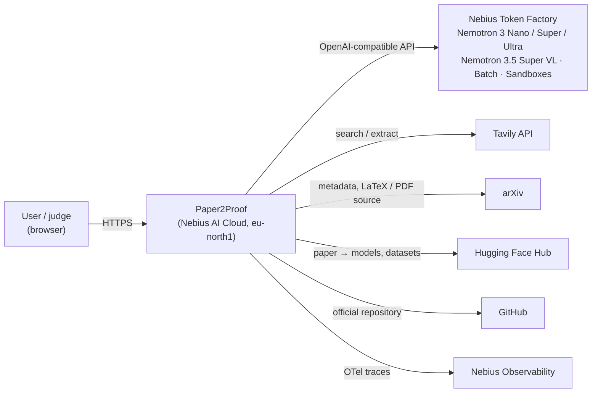
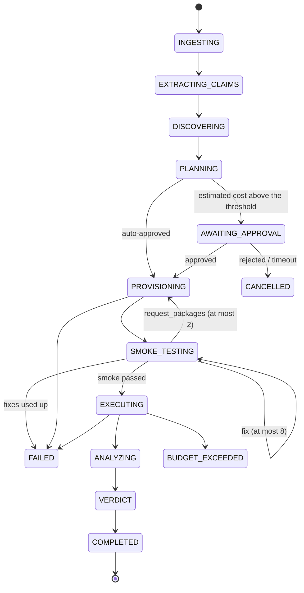
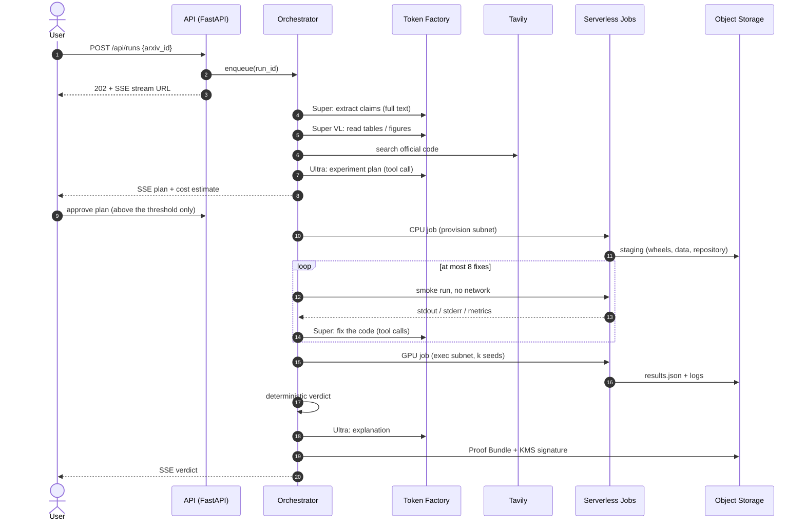
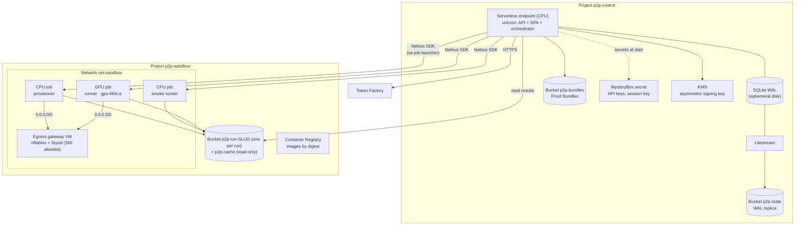
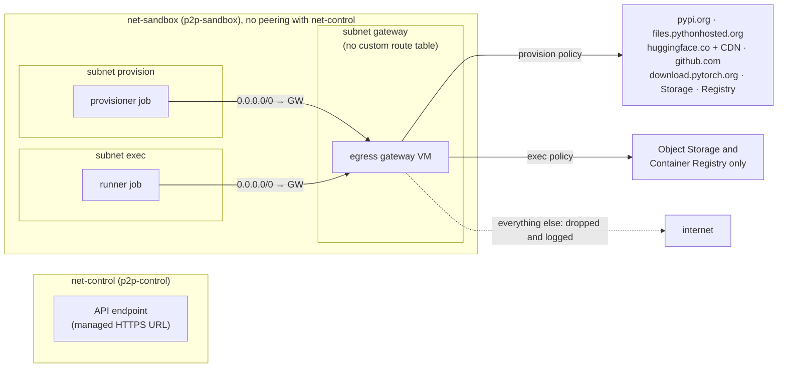

# Paper2Proof architecture

This document describes how Paper2Proof is built: the components, the trust boundaries, and
the reasons behind the main decisions.

> **The live service runs the hybrid deploy** ([specs/hybrid-deploy.md](specs/hybrid-deploy.md)).
> Our hackathon tenant never received the CPU quota the design below needs (the Serverless
> endpoint and the egress gateway), and L40S capacity was not available when we tested isolated
> GPU jobs. So the control plane runs on a host of ours behind TLS, provisioning runs in a
> locked-down container there, and the Coder's smoke runs and the experiment run in Nebius Token
> Factory Sandboxes with no network, on CPU. Buckets, the registry and the signing key stay on
> Nebius AI Cloud. The design described here is implemented and can be switched back on. The normative contracts live in
[`docs/specs/`](specs/), and the platform facts we verified on Nebius live in
[`docs/spikes/RESULTS.md`](spikes/RESULTS.md). When they disagree with this page, they win.

## 1. In one paragraph

A user submits an arXiv ID. The control plane downloads the paper and extracts its
quantitative claims with Nemotron models on Nebius Token Factory. It finds the official code,
plans a small experiment, and has a Coder model write it. The generated code is tested offline,
then runs on an L40S GPU in a Serverless job inside a separate, isolated Nebius project. A pure
function compares the measurements with the claim and returns the verdict. A model only
explains it. Every run ends with a Proof Bundle: everything that was claimed, run, measured and
paid for, hashed and signed so that anyone can check it and run it again.

## 2. Goals and non-goals

**Goals**

- A verdict that a researcher can trust: deterministic, with stated tolerances, seeds,
  confidence interval and conditions.
- Code written by a model never runs where secrets live.
- Every dollar is accounted for before it is spent: tokens, GPU minutes and daily caps.
- Each Nemotron model does the work it is best at, and the larger models run only where they
  are needed.

**Non-goals**

- Judging a paper or its authors. A verdict describes one run under stated conditions.
- Large-scale training. One GPU and about 30 GPU-minutes per run.
- Arbitrary input. Only arXiv IDs are accepted: no URLs, no PDF uploads.

## 3. System context



## 4. Pipeline

The orchestrator is an explicit finite-state machine, not a free-running agent. Every step is
persisted. A restarted process resumes unfinished runs, and job creation is get-by-name first,
so a retry never launches a second GPU job.



| Step | What happens | Who decides |
|---|---|---|
| `INGESTING` | Download the LaTeX source (or the PDF) from arXiv, hash it, parse the text, rasterize pages with tables or figures | Code (in the process pool) |
| `EXTRACTING_CLAIMS` | Reader extracts claims with metric, dataset, setting, value, std and source reference. Vision reads tables and figures from PDF pages | Super, Super VL |
| `DISCOVERING` | Find the official repository: GitHub URLs in the HF Papers summary and the abstract, then Tavily search; candidates ranked by Utility | Code, Tavily, Nano |
| `PLANNING` | Plan the experiment for the selected claim: dataset, packages, seeds, scale, GPU minutes, cost estimate. Code then corrects the plan against the limits | Ultra, code |
| `AWAITING_APPROVAL` | Plans estimated above $0.60 wait for the user's approval (30 minutes) | User |
| `PROVISIONING` | CPU job: validated wheels, datasets and the repository are packed into the run's bucket | Code only |
| `SMOKE_TESTING` | The Coder writes the experiment and runs it on a tiny data subset, offline, until it passes | Super (tools), code |
| `EXECUTING` | GPU job runs the experiment over k seeds, offline | Code |
| `ANALYZING` | `results.json` is validated against its schema and turned into measurements | Code |
| `VERDICT` | `decide()` returns the verdict; Judge writes the explanation; the Proof Bundle is built and signed | Code, Ultra |

### 4.1 Happy path



## 5. Verdict engine

`app/verdict/engine.py::decide()` is a pure function of the claim, the measurements and
`config/verdict.yaml`. It is covered by property-based tests at 100% branch coverage. The full
algorithm is in [`docs/specs/verdict-engine.md`](specs/verdict-engine.md). In short:

- **Tolerance band** for an absolute claim: the largest of 2% of the claimed value, twice the
  std reported by the paper, and a per-metric absolute floor (0.005 for accuracy, F1 and AUC).
- **Measurement:** the mean over seeds with a 95% confidence interval. At least 3 usable seeds;
  fewer is `INCONCLUSIVE` (`INSUFFICIENT_SEEDS`).
- **REPRODUCED** when the interval overlaps the band; **NOT_REPRODUCED** only when the whole
  interval is outside it **and** the run was at full scale.
- **Reduced scale:** a relative claim ("A beats B by 1.7 points") can be
  `REPRODUCED_AT_REDUCED_SCALE` when at least half the claimed gain is measured. An absolute
  number cannot be judged at reduced scale (`REDUCED_SCALE_ABSOLUTE`), and a reversed trend is
  `INCONCLUSIVE`, never a negative verdict.
- **Units:** the Coder declares whether the metric is a fraction, a percent or raw. The
  conversion is deterministic, printed as a "Scale:" line and recorded in `verdict.json`.

The Judge model writes the explanation from the verdict and a code-written Facts block (what
each number means, its sign, its unit and which side it favours), and quotes numbers only from
it. An explanation that names a different verdict is discarded and replaced by a template. The UI always shows a negative result as
**"Not reproduced under our conditions"**, with the conditions next to it.

## 6. Containers



| Component | Code | Responsibility |
|---|---|---|
| API | `app/api/` | Sessions and invites, runs, SSE, gallery, admin, rate limits, security headers |
| Orchestrator | `app/orchestrator/` | FSM, steps, budget and ledger, reaper, Coder tools |
| Models | `app/models/` | Token Factory client, role routing, structured output, untrusted wrapping, prompts, Batch API |
| Ingestion | `app/ingestion/` | arXiv download, LaTeX and PDF parsing, rasterization |
| Discovery | `app/discovery/` | HF Papers, Tavily, candidate ranking |
| Execution | `app/execution/` | Job backends (Nebius, local Docker for development, fake for tests), per-run buckets, package policy, smoke executors |
| Verdict | `app/verdict/` | `decide()`, scale alignment, limitations, explanation checks |
| Bundle | `app/bundle/` | Build, sign, store and verify Proof Bundles |
| Web | `web/` | React + Vite SPA served by the API, types generated from the OpenAPI schema |

**Why a modular monolith on one endpoint.** One process holds the API, the SPA and the
orchestrator. There is no cluster to run, SQLite has a single writer, and a deploy is one
image update. The work that needs isolation (provisioning and running generated code) is
already outside the process, in Serverless jobs.

## 7. Model routing

Roles are resolved at startup against `GET /v1/models` from
[`config/models.yaml`](../config/models.yaml). The process refuses to start when a role
resolves to no model, or to more than one. No model ID is hardcoded.

| Role | Model | Work | Reasoning |
|---|---|---|---|
| Reader | `nvidia/nemotron-3-super-120b-a12b` | Claim extraction from the full paper text | off |
| Vision | `nvidia/Nemotron-3.5-Super-VL` | Tables and figures from PDF pages | off |
| Utility | `nvidia/NVIDIA-Nemotron-3-Nano-30B-A3B` | Ranking repository candidates, repairing invalid JSON, small classification | off |
| Planner | `nvidia/Nemotron-3-Ultra-550b-a55b` | Planning the experiment | on |
| Coder | `nvidia/nemotron-3-super-120b-a12b` | Writing and fixing the experiment with tools | off |
| Judge | `nvidia/Nemotron-3-Ultra-550b-a55b` | Explaining the verdict | on |

- **Structured output** goes through forced tool calls for every role. Super returns empty
  content for `response_format: json_schema`, and tool calls work on all three models.
- **Reasoning** is switched with `chat_template_kwargs: {enable_thinking: ...}`. The
  system-prompt switches are ignored by these models.
- **Fallbacks:** Planner and Judge fall back to the Reader model; the Coder falls back to the
  Planner model. Vision has no text substitute: an unreadable page is skipped with a warning.
- **Retries:** exponential backoff with jitter, honouring the `x-ratelimit-reset-*` and
  `Retry-After` headers. Each attempt is charged to the ledger.
- **Untrusted input:** paper text, repository files and tool output are wrapped by
  `app/models/untrusted.py::wrap_untrusted()` before they enter a prompt.
- **Batch API** (half price) runs the claim-extraction evaluation and the routing ablation.

## 8. The Coder loop

The Coder is the only agentic loop, and it is bounded. Its tools:

| Tool | Effect | Guardrail |
|---|---|---|
| `read_file` | Read `workspace/<path>` or `repo/<path>` | Inside the run's files only; size cap |
| `write_file` / `apply_patch` | Change files in the workspace | `workspace/` only; 100 KB per file |
| `run_smoke` | Run the experiment with `--smoke` on the tiny data subset | Offline, timeout, fixed command shape |
| `search_docs` | Tavily search in library documentation | A few per run |
| `request_packages` | **Ask** for missing pip packages | Validated by code; at most 2 requests of 5 packages; back to `PROVISIONING` |
| `finish` | Declare the experiment ready | The entrypoint must exist and have passed its last smoke run |

The Coder cannot install packages, start jobs or reach the network. Those actions belong to
deterministic code. The experiment contract is fixed:
`python <entrypoint> --seed <int> --out <dir> [--smoke]`, writing `<dir>/metrics.json`. The
runner, not the script, loops over seeds and writes `results.json`.

## 9. Execution plane

### 9.1 Two phases: prepare with the network, run without it

| | Provision | Execute |
|---|---|---|
| Who chooses the commands | Our code only. No model output is executed | Code written by the Coder (untrusted) |
| Network | Allowlisted egress through the gateway (PyPI, Hugging Face, GitHub, PyTorch) | None, apart from Object Storage and the registry |
| Secrets | None | None |
| Output | `staging/` in the run's bucket | `results/` in the run's bucket |

Provisioner rules: wheels only (`--only-binary=:all:`), so no `setup.py` runs at install time.
Package names pass a policy (exists on PyPI, curated or popular list, no near-miss of a popular
name). The official repository is cloned, never installed during provisioning. The lock with
hashes goes into the Proof Bundle.

### 9.2 Images and jobs

- Four images, all referenced **by digest**: `p2p-api`, `p2p-provisioner`, `p2p-runner`
  (CUDA runtime, PyTorch and a pinned ML stack), `p2p-runner-cpu` (the same stack on CPU, for
  smoke runs). All run as a non-root user.
- **Job names are deterministic**: `p2p-<kind>-<slug>-<attempt>`, with buckets
  `p2p-run-<slug>`. Creation is get-by-name first.
- **One bucket per run.** A mounted volume exposes a whole bucket, so a shared read-write bucket
  would let one run read or change another run's results. The shared cache is mounted
  read-only. Jobs mount buckets by ID: the platform rejects names.
- **GPU job:** `gpu-l40s-a`, `1gpu-8vcpu-32gb`, 100 GiB disk, no restart (the orchestrator
  decides retries).
- **Watchdog in three layers**, because the platform timeout cannot go below one hour:
  `timeout` around the experiment in the entrypoint; a deadline in the orchestrator that cancels
  the job; and a reaper every 5 minutes for jobs and buckets that outlived their run.
- **Capacity:** a GPU job can wait in the queue for many minutes without any error. GPU budgets
  count from the job's start, not its creation. A job still queued after 20 minutes is cancelled
  and the run ends `INCONCLUSIVE (CAPACITY)`.
- **Smoke runs** use a CPU job in this design. The live service (hybrid deploy) runs them, and
  the experiment itself, in Token Factory Sandboxes with networking disabled.

### 9.3 Network isolation



- **Separate projects and networks.** Untrusted code never shares a network with the control
  plane. Nebius roles are granted per project, so the project split is also how least privilege
  is enforced.
- **The gateway is the enforcement point.** The default security group of a network allows
  everything and cannot be changed, so both subnets route `0.0.0.0/0` to a gateway VM. There,
  nftables redirects HTTPS to Squid, which allows or refuses each connection by SNI without
  decrypting it. Policies are per source subnet.
- **Fail-closed.** With the gateway down, jobs have no internet at all. The orchestrator starts
  the gateway before a run and stops it after 30 idle minutes.
- **Residual risks** are stated, not hidden: DNS through the VPC resolver, compute abuse inside
  the granted minutes, and hostile content in the run's own bucket. The control plane reads only
  a schema-validated, size-capped `results.json` and treats logs as text.

## 10. Identity, secrets and access

| Service account | Project | Used by | Can |
|---|---|---|---|
| `sa-ci-deployer` | both | GitHub Actions through OIDC federated credentials | Push images, update the endpoint, `terraform apply` |
| `sa-api-runtime` | p2p-control | The endpoint | State and bundle buckets, KMS signing |
| `sa-job-launcher` | p2p-sandbox only | The orchestrator | Jobs, per-run buckets, gateway start and stop |

- Secret **values** are loaded out of band (`deploy/secrets.sh`). Terraform creates only the
  secret container, so no value ever reaches Terraform state.
- **Jobs receive no secrets.** Only the control plane calls models and Tavily.
- **CI has no static cloud key.** The GitHub OIDC token (audience `sts.nebius.com`) is exchanged
  through the Nebius SDK for a short-lived token.
- **Users:** the public gallery and replays need no login. A live run needs an invite code,
  which becomes an `HttpOnly`, `Secure`, `SameSite=Strict` session cookie with a daily quota
  (3 runs per code by default). Runs are private to the session that started them.

## 11. Data and storage

- **State:** SQLite in WAL mode on the endpoint's ephemeral disk, replicated continuously by
  Litestream to `p2p-state`. At start the container restores the replica, runs Alembic
  migrations, and only then starts uvicorn under Litestream. A missing replica is an error
  outside the first bootstrap, so a restart can never reset the ledger or the kill switch.
- **SSE events** have monotonic IDs. Clients resume with `Last-Event-ID`, a heartbeat keeps the
  connection alive, and the UI falls back to polling.
- **Replay:** a gallery run replays its recorded events with compressed timing
  (`?replay=1&speed=10`). Nothing is executed and nothing is spent.
- **Buckets:** `p2p-state` (versioned replica), `p2p-bundles` (served through short-lived
  presigned URLs), `p2p-cache` (shared wheels and datasets, read-only in jobs),
  `p2p-run-<slug>` (one per run, deleted after the bundle is built), `p2p-tfstate`.

### 11.1 Proof Bundle

A deterministic `proof-bundle-<run_id>.tar.gz` ([`docs/specs/proof-bundle.md`](specs/proof-bundle.md)):

```
bundle/
├── MANIFEST.json        # sha256 and size of every file, versions, models, prompt hashes
├── SIGNATURE            # Nebius KMS signature of sha256(MANIFEST.json)
├── paper/metadata.json  # arXiv ID, title, source hash: never the paper itself
├── claims.json
├── plan.json
├── env/                 # provision report, install lock with hashes
├── code/                # the exact workspace the GPU job ran, smoke result, job manifests
├── results/<attempt>/   # results.json, logs, environment, analysis
├── verdict.json         # verdict, claim, tolerance config and its sha256
├── explanation.md       # explanation, with a Limitations section written by code
├── cost_receipt.json    # tokens and cost per role, jobs, totals
└── reproduce.sh         # re-runs the judged attempt locally with docker --gpus all
```

`python -m app.bundle.verify <bundle>` checks every hash and the signature with the public key.
The bundle is built with standard tools (`tar`, gzip), so it can also be checked by hand with
`openssl`.

## 12. Budget and limits

All limits live in [`config/budgets.yaml`](../config/budgets.yaml) and are checked by
`app/orchestrator/budget.py` **before** every model call and every job.

| Limit | Default |
|---|---|
| Tokens per run | 1.5M in, 150k out |
| Inference per run | $1.00 |
| GPU minutes per run | 30 |
| Coder fix iterations | 8 |
| Concurrent runs | 2 |
| Cloud spend per day | $15 (kill switch) |
| Inference per day | $6 |
| Live runs per invite | 3 per day |

Exceeding a limit ends the run as `BUDGET_EXCEEDED`, naming the limit. Prices live in
[`config/pricing.yaml`](../config/pricing.yaml). A model with no listed price is charged at the
highest known price until one is published.

## 13. Deploy, CI and infrastructure

- **Terraform** (`infra/terraform/`) manages projects, IAM, networks and subnets, route tables,
  the gateway VM and its cloud-init, buckets, the registry, secret containers and the KMS key.
  The Terraform provider has no resources for Serverless endpoints and jobs, so
  `deploy/endpoint.sh` creates or updates the endpoint, and the orchestrator creates jobs at run
  time through the Python SDK.
- **CI on every push:** ruff, mypy `--strict`, shellcheck, actionlint, oxlint and tsc; pytest and
  vitest; a license gate (no GPL or AGPL in shipped dependencies); the web build; Terraform
  `fmt`, `validate`, tflint and checkov; and a build of the four images with a size check.
- **Deploy from `main`, by hand:** build, SBOM (syft), vulnerability scan (trivy, fails on
  CRITICAL), push by digest, `terraform apply` in a protected environment, endpoint update after
  a drain, smoke test, and rollback to the previous digests on failure. It targets this design;
  the live service runs the hybrid deploy, updated from `develop` on its host, so a merge into
  `main` does not start it. It has not completed a run: on 2026-10-30 its scan step failed on the
  OCI archives (trivy reads a `docker save` tar or an OCI layout directory).
- **Daily smoke** (cron) checks the live service during judging (https://paper2proof.com unless a
  deploy recorded another URL).

## 14. Observability

- JSON logs with `run_id` and `trace_id`. Prompt bodies and paper text never appear at INFO
  level.
- OpenTelemetry traces exported to Nebius Tracing: one trace per run, one span per step and per
  model call, with role, model, tokens and cost.
- Every run shows a **cost receipt**: tokens and dollars per role, GPU and CPU job time, and the
  totals.

## 15. Failure modes

| Failure | Behaviour |
|---|---|
| 429 from Token Factory | Backoff honouring the reset headers, then the role's fallback |
| 5xx or timeout from a model | Idempotent retry, then `MODEL_UNAVAILABLE` |
| Invalid JSON | One repair by Utility (Nano), one retry on the original role, then `SCHEMA_ERROR` |
| No GPU capacity | `INCONCLUSIVE (CAPACITY)` after a refusal or 20 minutes in the queue |
| Project quota used up | The run ends with a message naming the quota |
| Stuck job | Watchdog and reaper cancel it; the step fails with `TIMEOUT` |
| Endpoint restart | Litestream restore; the FSM resumes runs and re-attaches launched jobs by name |
| Daily cap reached | Kill switch: new GPU runs are refused, the gallery stays up |

## 16. Threat model

| Threat | Controls |
|---|---|
| Prompt injection in the paper | Text wrapped as untrusted; the Coder has no network, install or job tools; privileged actions run only in deterministic code; the verdict does not depend on a model |
| Malicious generated or repository code | Separate project and network, allowlisted or no egress, no secrets, non-root user, per-run bucket, time budget |
| Exfiltration | Gateway refuses everything outside the allowlist; during execution only Object Storage remains |
| PyPI supply chain | Wheels only, name policy, lock with hashes, image scans |
| Denial of wallet | Invites with quotas, rate limits, per-run budgets, daily caps, kill switch, approval above a threshold |
| Tampered results | Per-run buckets, schema-validated `results.json`, signed bundles |
| SSRF | Input is an arXiv ID matched by `^\d{4}\.\d{4,5}(v\d+)?$`, nothing else |
| XSS or session theft | Sanitized Markdown with no raw HTML, strict CSP (`default-src 'self'`), strict cookies |
| Compromised CI | OIDC subject pinned to the repository, environment and branch; manual approval for `prod` |

### 16.1 Ethics

A negative verdict on a real paper, shared by link, can hurt real people. Negative results always
read "Not reproduced under our conditions", with the conditions listed. Runs are private by
default. Nothing enters the public gallery automatically, and a negative run on a real paper
only after a manual review. Bundles never redistribute the paper. Authors can report an error or
ask for a takedown ([README](../README.md#for-paper-authors)). Known limits are listed in
[`docs/LIMITATIONS.md`](LIMITATIONS.md).

## 17. Evaluation (ReproBench-mini)

| Set | Content | Measures |
|---|---|---|
| A, canaries | Small synthetic papers we wrote, with true and deliberately falsified claims (`eval/canaries/`) | Verdict accuracy and **false accusations** (a true claim judged not reproduced: target 0) |
| B, real papers | arXiv papers with official code and cheap experiments (`eval/set_b.yaml`) | Behaviour on real material, rate of inconclusive results |
| C, extraction | Hand-annotated claims (`eval/set_c/`) | Precision, recall and F1 of claim extraction |

The routing ablation runs set C with every role on Ultra and with the routed models, and
compares quality against cost. `make eval-report` turns `eval/results/` into the tables in the
README.

## 18. Decisions

| ADR | Decision | Rejected | Why |
|---|---|---|---|
| 001 | Modular monolith on a CPU Serverless endpoint | Managed Kubernetes; separate API and workers | No cluster to operate; one process; isolation already lives in jobs |
| 002 | SQLite + Litestream on Object Storage | Managed PostgreSQL | Ephemeral container disk, near-zero cost; SQLAlchemy keeps PostgreSQL one DSN away |
| 003 | Two projects (control and sandbox) | One project with security groups | Roles are per project and the default security group cannot be changed |
| 004 | Egress gateway with an SNI allowlist, fail-closed, on demand | Default egress; no network | Audited egress at near-zero cost while stopped |
| 005 | Two-phase execution: deterministic provision, offline execute | An agent with free network access | Model-written code never reaches the internet; install commands are never model-written |
| 006 | CPU jobs for smoke runs, GPU jobs for the experiment; Sandboxes as an alternative smoke executor | GPU jobs only | Cheap, offline iterations before any GPU minute |
| 007 | Explicit FSM with one bounded agentic loop | A free agent framework | Determinism, budgets, crash recovery, debuggability |
| 008 | Deterministic verdict; the model only explains | An LLM as judge | Scientific credibility; no hallucinated results |

## 19. Changes from the original design

- **Vision model.** Nemotron 3 Nano Omni is available only as a dedicated deployment, so the
  Vision role uses `nvidia/Nemotron-3.5-Super-VL`.
- **Smoke runs** use CPU Serverless jobs in production. Sandboxes passed the isolation spike and
  stay available as an alternative executor.
- **Capacity.** The platform queues a GPU job instead of refusing it, so budgets count from the
  job's start and a queue cap replaces the immediate fallback.
- **Volumes.** Jobs mount buckets by ID, so the orchestrator keeps the ID of each bucket it
  creates or finds.
- **Bundles** are gzip archives instead of zstd, so they can be verified with standard tools.
